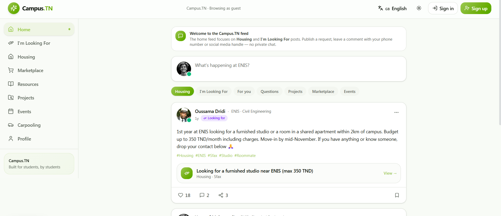
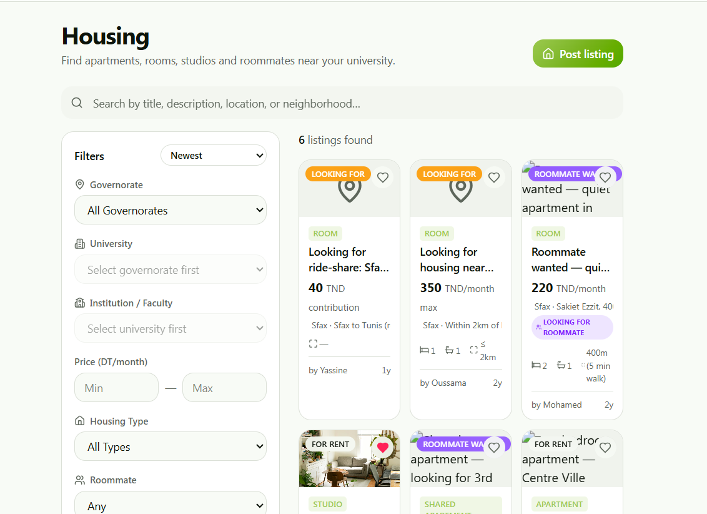
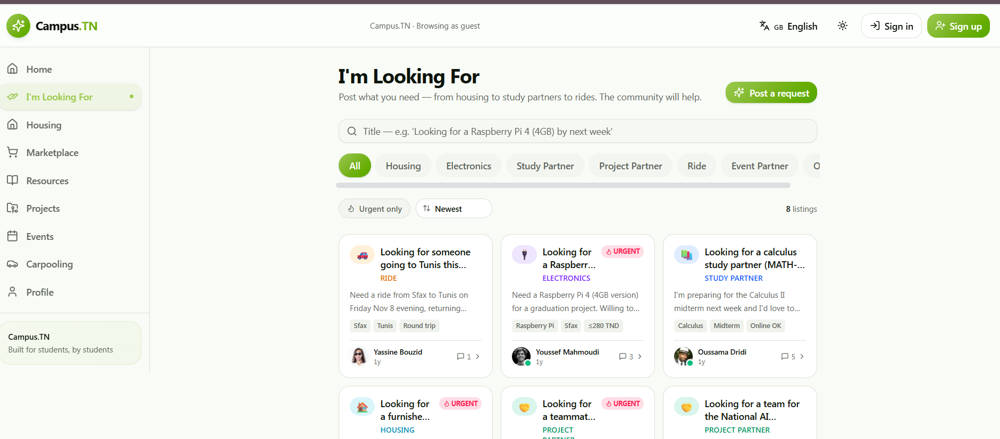

# Compus.tn — Student Community Platform

**Built for students, by students.**

Compus.tn is a student community platform designed to bring Tunisian university students together in one place. It aims to simplify student life by helping students find accommodation, connect with study partners, discover academic resources, and access campus-related services.

## About the Project

Student information in Tunisia is often scattered across social media groups and different platforms. Compus.tn aims to bring these services together in one organized space, helping students connect based on their governorate, university, and faculty.

Whether students are looking for housing, educational resources, project collaborators, or student activities, Compus.tn aims to make these experiences simpler and more accessible.

## Features

- **Housing:** Discover student accommodation, rooms, apartments, studios, and roommate opportunities.
- **I'm Looking For:** Publish requests for housing, electronics, study partners, project collaborators, rides, and more.
- **Community Feed:** Share posts and interact with the student community through likes and comments.
- **Marketplace:** Discover and share student-related products.
- **Academic Resources:** Share and access useful educational materials.
- **Projects & Collaboration:** Connect with students to work on academic and technical projects.
- **Events:** Discover and share student events and activities.
- **Carpooling:** Help students find shared rides and coordinate journeys.
- **Search & Filters:** Find relevant listings and requests more easily.
- **User Authentication:** Provide a foundation for personalized student experiences.

## Screenshots

### Home Page

  

The main dashboard of Compus.tn, bringing together student posts, community interactions, and campus-related information.

### Housing

Explore student accommodation opportunities, including rooms, apartments, studios, and roommate offers.

### I'm Looking For

Publish and discover student requests for housing, electronics, study partners, project collaborators, and other needs.

## Tech Stack

| Technology | Purpose |
|---|---|
| Next.js | Frontend framework |
| React | User interface |
| TypeScript | Type-safe frontend development |
| C# | Backend programming language |
| ASP.NET Core Web API | Backend API |
| Entity Framework Core | Database access and ORM |
| Microsoft SQL Server | Relational database |
| JWT | Authentication and authorization |

## Project Status

🚧 **Under Development**

Compus.tn is actively being developed. Features, design, and functionality may evolve as development progresses.

## Vision

The goal of Compus.tn is to build a centralized digital space for Tunisian university students — making it easier to find opportunities, exchange knowledge, collaborate, and navigate student life.

---

**Compus.tn — Connecting students, simplifying student life.**
